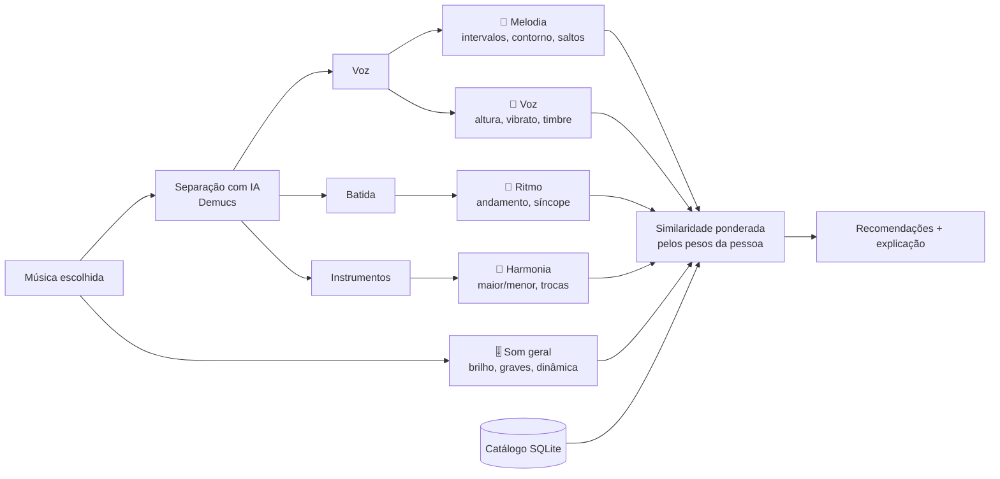

# 🎧 Sintonia

**Descubra o que te pega numa música e encontre outras com a mesma coisa.**

👉 **[Abrir o app](https://sintonia-laise.streamlit.app/)**

## Por que eu fiz este projeto

Sempre soube que algumas músicas tinham *alguma coisa* que me pegava, mas nunca soube dizer o quê. Era a melodia? A voz? A batida? Os aplicativos de música recomendam por gênero ou pelo que outras pessoas ouviram, e isso não resolvia: eu queria músicas que tivessem **aquela mesma coisa**, mesmo sem saber nomeá-la.

Quando comecei a pensar no problema, percebi que, no meu caso, o que me atrai é principalmente a **melodia** e, em segundo lugar, a **voz**. E percebi também que muita gente passa pelo mesmo: sente, mas não tem vocabulário musical para explicar.

Então o Sintonia foi pensado para pessoas leigas. Em vez de pedir que a pessoa descreva o que gosta, ele deixa ela **descobrir ouvindo**.

## Como eu construí

Construí o Sintonia em parceria com o **Claude**, a IA da Anthropic. Funcionou como uma dupla:

- **Eu** trouxe o problema, defini para quem era o app e tomei as decisões do projeto: analisar pelo áudio, criar o teste de escuta, usar Deezer e Jamendo como fontes, não guardar áudio de ninguém, mostrar a porcentagem de compatibilidade, filtrar por idioma, escolher o visual. Também montei o catálogo no Google Colab, publiquei o app e testei tudo com músicas que eu conheço.
- **O Claude** escreveu o código, me explicou cada etapa e me ajudou a resolver os erros que foram aparecendo pelo caminho.

Foi meu primeiro projeto de dados com áudio, e usar uma IA como parceira me permitiu ir muito além do que eu conseguiria sozinha agora, entendendo cada decisão no caminho.

## Como funciona

1. A pessoa escolhe uma música, buscando pelo nome no Deezer ou no Jamendo, ou enviando o arquivo.
2. O app **separa a música com IA** e toca cada parte isolada: só a voz, só os instrumentos, só a batida.
3. A pessoa marca a parte que tem "aquilo". O app ajusta a busca, e ela ainda pode refinar o quanto cada aspecto importa.
4. O app compara com o catálogo e mostra as músicas mais parecidas, com a **% de compatibilidade** e uma explicação em português simples, como *"As duas têm melodia com saltos grandes entre as notas; voz com bastante vibrato"*.
5. Dá para **filtrar por idioma** (português, inglês, espanhol, japonês, coreano e outros) e abrir cada música no YouTube, YouTube Music, Spotify, Deezer ou Jamendo.



### Os cinco aspectos que o app compara

| Aspecto | Onde é medido | O que entra na conta |
|---|---|---|
| 🎵 Melodia | voz isolada | intervalos entre as notas, se a melodia sobe ou desce, saltos e passos, extensão, notas por segundo |
| 🎤 Voz | voz isolada | região (grave ou aguda), vibrato, brilho, soprosidade, timbre (MFCCs) |
| 🥁 Ritmo | batida e mistura | andamento, ataques por segundo, regularidade, síncope, peso da percussão |
| 🎹 Harmonia | instrumentos | maior ou menor, clareza do tom, complexidade, trocas de acorde |
| 🎚️ Som geral | mistura | brilho, graves, dinâmica, contraste, timbre geral (MFCCs) |

## Decisões que tomei

**Comparar pelo som, não pelo gênero.** Duas músicas de gêneros diferentes podem ter a mesma coisa que me atrai. Por isso o app analisa o áudio de cada música, e não etiquetas como "pop" ou "MPB".

**A melodia não depende do tom.** O app descreve a melodia pelos *intervalos* entre as notas, e não pelas notas em si. Assim, a mesma melodia cantada mais aguda ou mais grave continua sendo reconhecida como parecida. Nos testes, a mesma melodia transposta deu distância 0,004, contra 4,8 de uma melodia diferente.

**Cada pessoa decide o que importa.** A compatibilidade final é uma média ponderada pelos pesos que a pessoa escolhe. No meu caso, uso melodia alta e voz média.

**Não guardar áudio de ninguém.** O áudio é baixado, analisado e apagado. O banco guarda só números e o identificador de cada música, e o app toca a prévia direto da fonte.

**O YouTube só para ouvir.** Pensei em usar o YouTube para analisar as músicas, mas os termos de uso proíbem baixar o áudio. Então ele entrou só como link para ouvir a música inteira.

**Idioma detectado pela voz.** Para o filtro de idioma, uso o Whisper ouvindo só a voz separada, sem os instrumentos, o que deixa a detecção mais confiável. Quando ele não tem certeza, a música fica como "não identificado", em vez de ir para o idioma errado.

## Ferramentas

- **Python**: librosa (análise de áudio), Demucs (separação da voz), Whisper (idioma), pandas, scikit-learn
- **SQL**: SQLite para o catálogo e para registrar o uso do app (`sql/schema.sql`, `sql/consultas.sql`)
- **Streamlit**: o app
- **Google Colab**: para montar o catálogo com GPU gratuita
- **Power BI**: painel de análise (`powerbi/README.md`)

## O que aprendi

- As APIs de música só liberam **prévias de 30 segundos**. Para analisar músicas inteiras, usei também o Jamendo, que tem músicas completas com licença livre.
- **Separar a voz** da música com IA abre muitas possibilidades: dá para medir a melodia e o timbre sem a interferência dos instrumentos.
- O **Colab com GPU** deixa a separação de voz umas 20 vezes mais rápida do que sem GPU.
- Respeitar **direitos autorais e privacidade** muda o desenho do projeto: não guardar áudio, não baixar do YouTube e não dar acesso ao Google Drive inteiro quando não é necessário.

## O que ainda não está bom

- Prévias de 30 segundos podem pegar só um pedaço da música, como o refrão ou a introdução.
- A separação por IA não é perfeita: um pouco dos instrumentos pode vazar na voz.
- Melodia e voz só funcionam em músicas cantadas. As instrumentais são comparadas só por ritmo, harmonia e som.
- A melodia segue a voz principal, então backing vocals e duetos confundem um pouco.

## Próximos passos

- Usar os 👍 e 👎 do app para **aprender sozinho** quais características importam mais.
- Comparar o meu método com modelos de música pré-treinados, como MERT e CLAP.
- Montar o painel no Power BI com o que as pessoas mais buscam.

## Estrutura do projeto

```
app.py                         o app (Streamlit)
sintonia/
  fontes.py                    APIs do Deezer e do Jamendo
  audio.py                     carregar e separar a música
  caracteristicas.py           os 5 aspectos em números
  recomendador.py              similaridade, recomendação e explicação
  descricoes.py                textos em português simples
  idioma.py                    idioma cantado (Whisper)
  links.py                     links para YouTube, Spotify, Deezer...
  estilo.py                    visual "vinil retrô" do app
  banco.py                     SQLite
  catalogo.py                  monta o catálogo
  exportar.py                  CSVs para o Power BI
notebooks/
  01_montar_catalogo.ipynb     monta o catálogo no Colab
  02_explorar_catalogo.ipynb   análise exploratória com SQL e mapas
sql/                           estrutura do banco e consultas de exemplo
powerbi/                       guia do painel e CSVs exportados
tests/                         testes com músicas sintéticas
dados/catalogo.db              o catálogo (só números, sem áudio)
```

## Para rodar no seu computador

```bash
pip install -r requirements.txt
streamlit run app.py
```

O Jamendo pede uma chave gratuita ([devportal.jamendo.com](https://devportal.jamendo.com)), que vai em `.streamlit/secrets.toml` (veja `.streamlit/secrets.toml.exemplo`). Para montar um catálogo novo, use o notebook `notebooks/01_montar_catalogo.ipynb` no Google Colab.
