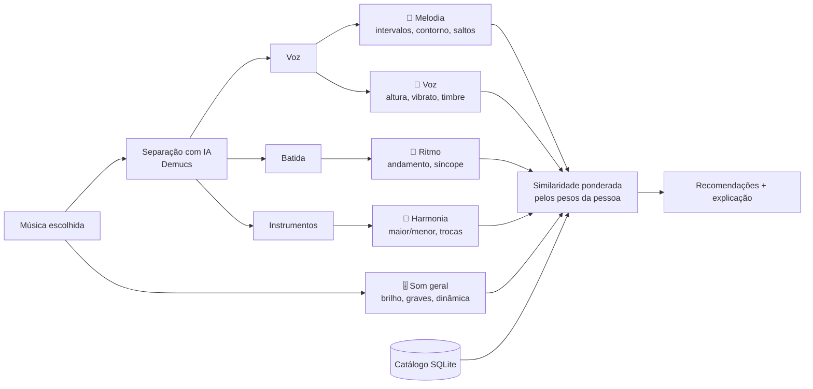

# 🎧 Sintonia

**Descubra o que te cativa numa música e encontre outras com a mesma coisa.**

👉 **[Abrir o app](https://sintonia-laise.streamlit.app/)**

## Por que eu fiz este projeto

Sempre soube que algumas músicas tinham *alguma coisa* que me cativava, mas nunca soube dizer o quê. Era a melodia? A voz? A batida? Os aplicativos de música recomendam por gênero ou pelo que outras pessoas ouviram, e isso não resolvia: eu queria músicas que tivessem **aquela mesma coisa**, mesmo sem saber nomeá-la.

Quando comecei a pensar no problema, percebi que, no meu caso, o que mais me atrai é o **instrumental**: a batida, a melodia e tudo o que os instrumentos fazem juntos. E percebi também que muita gente passa pelo mesmo: sente, mas não tem vocabulário musical para explicar.

Então o Sintonia foi pensado para pessoas leigas. Em vez de pedir que a pessoa descreva o que gosta, ele deixa ela **descobrir ouvindo**.

## Como eu construí

Construí o Sintonia em parceria com o **Claude**, a IA da Anthropic. Funcionou como uma dupla:

- **Eu** trouxe o problema, defini para quem era o app e tomei as decisões do projeto: analisar pelo áudio, criar o teste de escuta, usar Deezer e Jamendo como fontes, não guardar áudio de ninguém, mostrar a porcentagem de compatibilidade, filtrar por idioma, deixar a pessoa decidir se o gênero entra na busca, mostrar as informações da música e escolher o visual. Também montei o catálogo no Google Colab, publiquei o app e testei tudo com músicas que eu conheço.
- **O Claude** escreveu o código, me explicou cada etapa e me ajudou a resolver os erros que foram aparecendo pelo caminho.

Foi meu primeiro projeto de dados com áudio, e usar uma IA como parceira me permitiu ir muito além do que eu conseguiria sozinha agora, entendendo cada decisão no caminho.

## Como funciona

1. **A pessoa escolhe uma música**, buscando pelo nome no Deezer ou no Jamendo, ou enviando o arquivo.
2. **O app mostra as informações dela**: gênero, álbum, ano, gravadora e duração, além do tom e do andamento, que o próprio app mede.
3. **Teste de escuta.** O app separa a música com IA e toca cada parte isolada: só a voz, só os instrumentos, só a batida. A pessoa marca a parte que tem "aquilo".
4. **Ajustes.** O app já sugere o quanto cada aspecto importa (melodia, voz, ritmo, harmonia, som geral), e a pessoa pode refinar. Ela também decide como o gênero entra na busca:
   - não usar gênero, recomendando só pelo som;
   - dar preferência a alguns gêneros, sem excluir os outros;
   - receber só músicas dos gêneros escolhidos.

   O app sugere o gênero da música e os gêneros que mais soam parecidos com ela.
5. **Resultados.** A música analisada aparece no topo e, embaixo, as mais parecidas, cada uma com a **% de compatibilidade** e uma explicação em português simples, como *"As duas têm melodia com saltos grandes entre as notas; voz com bastante vibrato"*. Dá para **filtrar por idioma**, ouvir a prévia, abrir a música no YouTube, YouTube Music, Spotify, Deezer ou Jamendo, e marcar **Gostei** ou **Não gostei**.



### Os cinco aspectos que o app compara

| Aspecto | Onde é medido | O que entra na conta |
|---|---|---|
| 🎵 Melodia | voz isolada | intervalos entre as notas, se a melodia sobe ou desce, saltos e passos, extensão, notas por segundo |
| 🎤 Voz | voz isolada | região (grave ou aguda), vibrato, brilho, soprosidade, timbre (MFCCs) |
| 🥁 Ritmo | batida e mistura | andamento, ataques por segundo, regularidade, síncope, peso da percussão |
| 🎹 Harmonia | instrumentos | maior ou menor, clareza do tom, complexidade, trocas de acorde |
| 🎚️ Som geral | mistura | brilho, graves, dinâmica, contraste, timbre geral (MFCCs) |

## O catálogo

O app recomenda a partir de um catálogo que eu montei: **650 músicas**, 600 do Deezer e 50 do Jamendo, de dezenas de estilos. Cada música foi analisada uma vez, no Google Colab, e virou números. O áudio foi apagado.

| | |
|---|---|
| Com voz cantada | 611 |
| Idiomas | 434 em português, 130 em inglês e algumas em espanhol, japonês e outros |
| Gêneros mais comuns | Música brasileira, Pop, Alternativo, Rock, Soul & Funk, Música latina, Gospel |

## Decisões que tomei

**Comparar pelo som, não pelo gênero.** Duas músicas de gêneros diferentes podem ter a mesma coisa que me atrai. Por isso o app analisa o áudio de cada música, e não etiquetas como "pop" ou "MPB".

**A melodia não depende do tom.** O app descreve a melodia pelos *intervalos* entre as notas, e não pelas notas em si. Assim, a mesma melodia cantada mais aguda ou mais grave continua sendo reconhecida como parecida. Nos testes, a mesma melodia transposta deu distância 0,004, contra 4,8 de uma melodia diferente.

**Cada pessoa decide o que importa.** A compatibilidade final é uma média ponderada pelos pesos que a pessoa escolhe. No meu caso, deixo mais alto o que vem do instrumental: ritmo, harmonia, som geral e melodia.

**O gênero é opcional.** Como o foco é o som, o gênero não entra na busca a menos que a pessoa queira. Ela escolhe entre não usar, dar preferência (as músicas dos gêneros escolhidos sobem na lista, mas as outras continuam aparecendo) ou filtrar. Na preferência, a porcentagem de compatibilidade não muda, só a ordem.

**Não guardar áudio de ninguém.** O áudio é baixado, analisado e apagado. O banco guarda só números e o identificador de cada música, e o app toca a prévia direto da fonte.

**O YouTube só para ouvir.** Pensei em usar o YouTube para analisar as músicas, mas os termos de uso proíbem baixar o áudio. Então ele entrou só como link para ouvir a música inteira.

**Gêneros parecidos medidos pelo som.** O gênero de cada música vem do Deezer e do Jamendo, mas quais gêneros são "parecidos" com a música analisada eu calculo pelo som: para cada gênero, faço a média das cinco músicas dele mais compatíveis. Assim, a sugestão muda conforme o que a pessoa escolheu valorizar (melodia, voz, ritmo...). Quando a música não tem gênero informado, o app estima pelo gênero das músicas mais parecidas e avisa que é uma estimativa.

**Idioma detectado pela voz.** Para o filtro de idioma, uso o Whisper ouvindo só a voz separada, sem os instrumentos, o que deixa a detecção mais confiável. Quando ele não tem certeza, a música fica como "não identificado", em vez de ir para o idioma errado.

## Ferramentas

- **Python**: librosa (análise de áudio), Demucs (separação da voz), Whisper (idioma), pandas, scikit-learn
- **APIs**: Deezer e Jamendo (músicas, prévias, gêneros e informações dos álbuns)
- **SQL**: SQLite para o catálogo e para registrar o uso do app (`sql/schema.sql`, `sql/consultas.sql`)
- **Streamlit**: o app
- **Google Colab**: para montar o catálogo com GPU gratuita
- **GitHub Actions**: preenche o gênero das músicas do catálogo automaticamente
- **Power BI**: painel de análise (`powerbi/README.md`)

## O que aprendi

- As APIs de música só liberam **prévias de 30 segundos**. Para analisar músicas inteiras, usei também o Jamendo, que tem músicas completas com licença livre.
- **Separar a voz** da música com IA abre muitas possibilidades: dá para medir a melodia e o timbre sem a interferência dos instrumentos.
- O **Colab com GPU** deixa a separação de voz umas 20 vezes mais rápida do que sem GPU.
- Respeitar **direitos autorais e privacidade** muda o desenho do projeto: não guardar áudio, não baixar do YouTube e não dar acesso ao Google Drive inteiro quando não é necessário.
- Dá para **automatizar etapas de dados** com o GitHub Actions: o gênero das 650 músicas foi preenchido sem eu precisar rodar nada no meu computador.
- Os dados das plataformas têm limites: o Deezer, por exemplo, classifica quase toda música nacional apenas como "Música brasileira".

## O que ainda não está bom

- Prévias de 30 segundos podem pegar só um pedaço da música, como o refrão ou a introdução.
- A separação por IA não é perfeita: um pouco dos instrumentos pode vazar na voz.
- Melodia e voz só funcionam em músicas cantadas. As instrumentais são comparadas só por ritmo, harmonia e som.
- A melodia segue a voz principal, então backing vocals e duetos confundem um pouco.
- O gênero "Música brasileira" junta estilos muito diferentes, como sertanejo, forró, MPB e pagode.
- O catálogo tem poucas músicas em espanhol, japonês e coreano, então o filtro desses idiomas traz poucos resultados.

## Próximos passos

- Usar o **Gostei** e o **Não gostei** do app para aprender quais características importam mais.
- Separar "Música brasileira" em subgêneros, como sertanejo, forró, MPB e pagode.
- Ampliar o catálogo com mais músicas latinas, de K-pop e de J-pop.
- Comparar o meu método com modelos de música pré-treinados, como MERT e CLAP.
- Montar o painel no Power BI com o que as pessoas mais buscam.

## Estrutura do projeto

```
app.py                         o app (Streamlit)
sintonia/
  fontes.py                    APIs do Deezer e do Jamendo
  audio.py                     carregar e separar a música
  caracteristicas.py           os 5 aspectos em números
  recomendador.py              similaridade, recomendação e explicação
  descricoes.py                textos em português simples
  idioma.py                    idioma cantado (Whisper)
  generos.py                   gênero e informações da música (Deezer, Jamendo)
  links.py                     links para YouTube, Spotify, Deezer...
  estilo.py                    visual "vinil retrô" do app
  banco.py                     SQLite
  catalogo.py                  monta o catálogo
  exportar.py                  CSVs para o Power BI
notebooks/
  01_montar_catalogo.ipynb     monta o catálogo no Colab
  02_explorar_catalogo.ipynb   análise exploratória com SQL e mapas
sql/                           estrutura do banco e consultas de exemplo
powerbi/                       guia do painel e CSVs exportados
tests/                         testes com músicas sintéticas
.github/workflows/generos.yml  preenche o gênero do catálogo automaticamente (GitHub Actions)
dados/catalogo.db              o catálogo (só números, sem áudio)
```

## Para rodar no seu computador

```bash
pip install -r requirements.txt
streamlit run app.py
```

O Jamendo pede uma chave gratuita ([devportal.jamendo.com](https://devportal.jamendo.com)), que vai em `.streamlit/secrets.toml` (veja `.streamlit/secrets.toml.exemplo`). Para montar um catálogo novo, use o notebook `notebooks/01_montar_catalogo.ipynb` no Google Colab.
