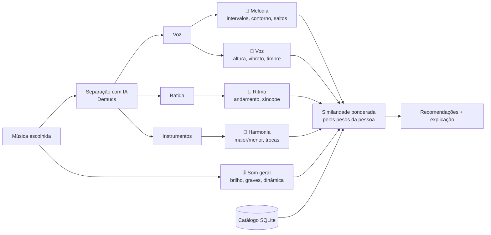

# 🎧 Sintonia

**Descubra o que te pega numa música — e encontre outras com a mesma coisa.**

Muita gente sabe que uma música tem *alguma coisa* especial, mas não sabe dizer o quê: a melodia? a voz? a batida? os acordes? O Sintonia resolve isso **pela escuta**, sem exigir vocabulário musical:

1. Você escolhe uma música (busca pelo nome no Deezer ou no Jamendo, ou envia o arquivo).
2. O app **separa a música com IA** e toca cada parte isolada: só a voz, só os instrumentos, só a batida.
3. Você marca a parte que tem "aquilo". O app ajusta o que buscar, e você ainda pode refinar.
4. O app compara com um catálogo e **explica cada recomendação** em português simples, por exemplo: *"As duas têm melodia com saltos grandes entre as notas; voz com bastante vibrato"*, com a **% de compatibilidade** geral e por aspecto.
5. Dá para **filtrar os resultados por idioma** (português, inglês, espanhol, japonês, coreano e outros) e abrir cada música no YouTube, YouTube Music, Spotify, Deezer ou Jamendo.

## Como funciona



### Os cinco aspectos

| Aspecto | Onde é medido | Exemplos de características |
|---|---|---|
| 🎵 Melodia | voz isolada | histograma de intervalos, contorno (sobe/desce), proporção de saltos e passos, extensão, notas por segundo |
| 🎤 Voz | voz isolada | região (grave/aguda), vibrato, brilho, soprosidade, MFCCs do timbre |
| 🥁 Ritmo | batida + mistura | andamento, ataques por segundo, regularidade, síncope, peso da percussão |
| 🎹 Harmonia | instrumentos | maior × menor, clareza do tom, complexidade, trocas de acorde |
| 🎚️ Som geral | mistura | brilho, largura espectral, graves, dinâmica, contraste, MFCCs |

**Melodia e harmonia não dependem do tom.** A melodia é descrita pelos *intervalos* entre as notas, e as escalas pela magnitude da transformada de Fourier do perfil de notas. Assim, a mesma melodia cantada mais aguda ainda é reconhecida como parecida (testado: distância 0,004 contra 4,8 de uma melodia diferente).

### Recomendação

1. Cada característica é padronizada (z-score) em relação ao catálogo.
2. Para cada aspecto, calcula-se a similaridade de cosseno, com cada grupo de características (ex.: os 25 intervalos) pesando igual, para um vetor grande não abafar o resto.
3. A nota final é a média ponderada pelos pesos que a pessoa escolheu. Há no máximo 2 músicas por artista, para variar.
4. A explicação lista as características interpretáveis em que **as duas músicas fogem da média na mesma direção**.

## Tecnologias

- **Python**: librosa (análise de áudio), Demucs (separação), Whisper (idioma cantado), pandas, scikit-learn
- **SQL**: SQLite para o catálogo e o uso do app (`sql/schema.sql`, `sql/consultas.sql`)
- **Streamlit**: o app
- **Power BI**: painel de análise (`powerbi/README.md`)
- **Google Colab**: monta o catálogo com GPU grátis

## Estrutura

```
app.py                         o app (Streamlit)
sintonia/
  fontes.py                    APIs do Deezer e do Jamendo
  audio.py                     carregar e separar (Demucs ou método leve)
  caracteristicas.py           os 5 aspectos em números
  recomendador.py              similaridade, recomendação e explicação
  descricoes.py                textos em português para leigos
  idioma.py                    idioma cantado (Whisper, na voz isolada)
  links.py                     links para YouTube, Spotify, Deezer...
  estilo.py                    visual "vinil retrô" do app
  banco.py                     SQLite
  catalogo.py                  monta o catálogo (linha de comando)
  exportar.py                  CSVs para o Power BI
notebooks/
  01_montar_catalogo.ipynb     Colab: monta o catálogo passo a passo
  02_explorar_catalogo.ipynb   análise exploratória com SQL e mapas
sql/                           schema e consultas de exemplo
powerbi/                       guia do painel + CSVs exportados
tests/                         testes com músicas sintéticas
dados/catalogo.db              o catálogo (gerado pelo notebook 01)
```

## Como rodar

### 1. Montar o catálogo (Colab, com GPU)
Abra `notebooks/01_montar_catalogo.ipynb` no [Google Colab](https://colab.research.google.com) e siga os passos. No final, coloque o `catalogo.db` baixado na pasta `dados/`.

### 2. Rodar o app no computador
```bash
pip install -r requirements.txt
streamlit run app.py
```
Para usar o Jamendo, copie `.streamlit/secrets.toml.exemplo` para `.streamlit/secrets.toml` e coloque seu `JAMENDO_CLIENT_ID` (grátis em [devportal.jamendo.com](https://devportal.jamendo.com)).

### 3. Publicar de graça
No [Streamlit Community Cloud](https://streamlit.io/cloud), crie um app apontando para este repositório e `app.py`, e cole o `JAMENDO_CLIENT_ID` em **Settings → Secrets**. Sem GPU, a separação leva de alguns segundos (prévias de 30 s) a alguns minutos (músicas inteiras).

### Testes
```bash
pip install -r requirements-dev.txt
python -m pytest -q
```

## Fontes das músicas e direitos autorais

- **Deezer**: músicas famosas, mas a API só libera **prévias de 30 segundos**.
- **Jamendo**: músicas **completas** sob licenças Creative Commons, de artistas independentes.
- **Arquivo próprio**: a pessoa pode enviar o arquivo para analisar a música inteira.

**Nenhum áudio é guardado.** O áudio é baixado, analisado e apagado. O repositório e o banco guardam só números e o identificador de cada música, e o app toca a prévia direto da fonte.

## Limitações

- Prévias de 30 s podem pegar só uma parte da música (refrão, introdução).
- A separação por IA não é perfeita: um pouco do instrumental pode vazar na voz.
- Catálogo e música escolhida devem usar o mesmo método de separação (o app avisa quando não é o caso).
- Melodia e voz só funcionam em músicas cantadas; instrumentais usam ritmo, harmonia e som.
- A extração de melodia segue a voz principal; backing vocals e duetos confundem um pouco.

## Próximos passos

- Usar 👍/👎 do app para **aprender os pesos** de cada característica.
- Incluir embeddings de modelos de música pré-treinados (MERT, CLAP) como mais um aspecto.
- Analisar mais de um trecho por música quando a fonte permitir.
